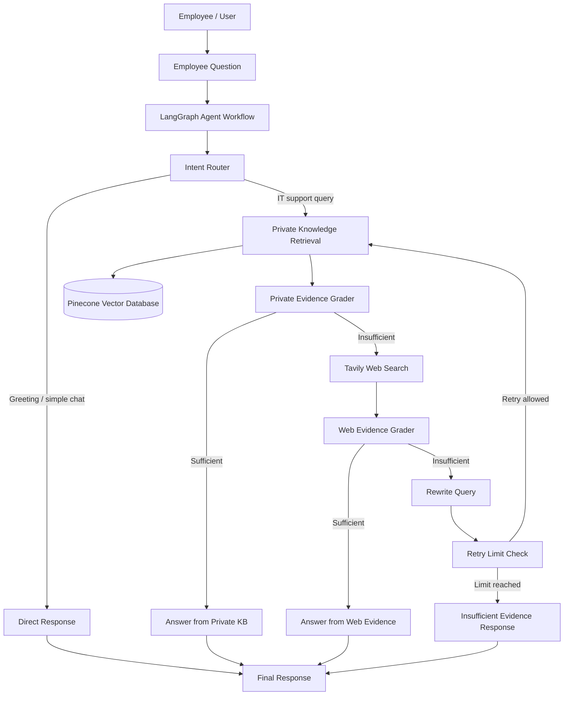
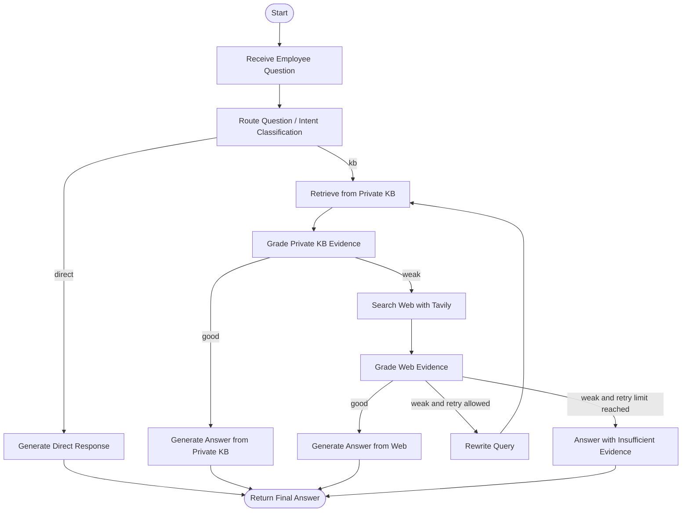
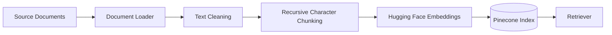
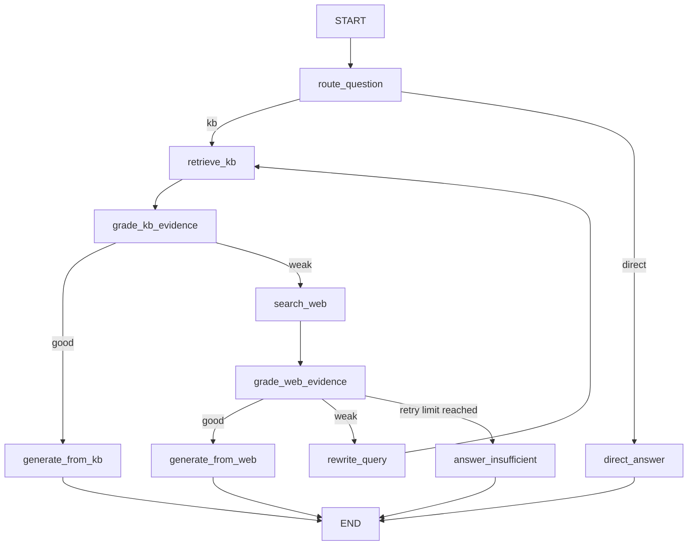
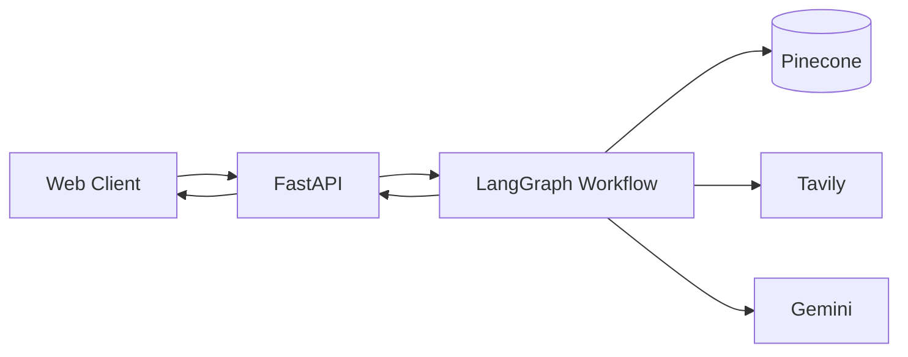

# 🤖 Agentic RAG — IT Support Assistant

<p align="center">
  <b>An intelligent IT support assistant that searches private knowledge first, checks whether the evidence is reliable, and uses web search only when needed.</b>
</p>

<p align="center">
  
  
  
  
  
</p>

---

## 📚 Contents

<details open>
<summary><b>Click to expand navigation</b></summary>

- [Overview](#-overview)
- [Problem and Solution](#-problem-and-solution)
- [What Makes It Agentic](#-what-makes-it-agentic)
- [Architecture](#-architecture)
- [Agent Workflow](#-agentic-rag-workflow)
- [Models and Configuration](#-models-and-configuration)
- [Knowledge Ingestion](#-knowledge-base-ingestion)
- [Technology Stack](#-technology-stack)
- [Project Structure](#-project-structure)
- [Setup](#-setup-and-installation)
- [Environment Variables](#-environment-variables)
- [Run the Project](#-run-the-project)
- [Test Scenarios](#-test-scenarios)
- [Workflow State and Nodes](#-langgraph-state-and-nodes)
- [Reliability and Security](#-reliability-and-security)
- [Troubleshooting](#-troubleshooting)
- [Deployment Notes](#-deployment-notes)
- [Roadmap](#-roadmap)
</details>

---

## 🎯 Overview

The **Agentic RAG — IT Support Assistant** is an end-to-end learning and engineering project for answering common employee IT support questions using a combination of private knowledge retrieval and external web search.

Example questions include:

- “My VPN is not connecting. What should I check?”
- “How do I reset my password?”
- “I cannot access Microsoft Teams.”
- “What does the authentication guidance say about MFA?”
- “Is there a current issue affecting a third-party service?”

Unlike a basic chatbot, the assistant does not immediately generate an answer after retrieval. It evaluates the retrieved evidence, decides whether another source is needed, can rewrite a weak query, and stops after a configured retry limit.

### Project at a glance

| Area | Implementation |
|---|---|
| Agent orchestration | LangGraph |
| LLM | `gemini-3.5-flash-lite` |
| Embedding model | `sentence-transformers/all-MiniLM-L6-v2` |
| Embedding dimension | 384 |
| Vector database | Pinecone |
| External search | Tavily |
| LLM / retrieval integration | LangChain |
| Development environment | Python 3.11, Jupyter Notebook |
| Application/API dependencies | FastAPI and Uvicorn are included in the environment requirements |

> **Implementation scope:** The notebook-based Agentic RAG workflow, Gemini integration, Hugging Face embeddings, Pinecone retrieval, Tavily fallback, evidence grading, query rewriting, retry handling, and response generation are the core implementation documented here. A production web UI, authenticated admin upload flow, persistent audit service, and deployed API should only be described as implemented after their corresponding application code is present and tested in the repository.

---

## 🧩 Problem and Solution

### The problem

Employees often need help with VPN connectivity, password and authentication issues, MFA, collaboration tools, software access, and general laptop or network troubleshooting. The relevant information may be spread across policy documents, technical guides, runbooks, and vendor documentation.

A simple keyword search may not find semantically relevant passages. A basic chatbot may also produce an answer even when the retrieved material does not support it. In addition, private documentation may not contain the latest information about an external vendor service.

### The solution

The assistant uses a controlled retrieval-and-decision workflow:

1. Classify the incoming message.
2. Send IT support questions to the private knowledge base first.
3. Grade the retrieved evidence.
4. Answer from private knowledge when the evidence is sufficient.
5. Use Tavily when private evidence is weak.
6. Grade the web evidence before using it.
7. Rewrite the query and retry when evidence is still insufficient.
8. Return an insufficient-evidence response when the retry limit is reached.

### Design principles

- **Private knowledge first:** internal or supplied knowledge is checked before external search.
- **Evidence before generation:** retrieved content is graded before it is passed to answer generation.
- **Fallback, not blind browsing:** web search is conditional, not the default path.
- **Bounded retries:** query rewriting cannot loop forever.
- **Transparent failure:** the system can say when it does not have enough evidence.

---

## 🧠 What Makes It Agentic?

A conventional RAG pipeline is commonly represented as:

```text
Question → Retrieve Documents → Generate Answer
```

This project adds decision-making between those stages:

```text
Question
   ↓
Classify Intent
   ↓
Retrieve Private Knowledge
   ↓
Evaluate Evidence
   ├── Sufficient → Generate from Private Knowledge
   └── Weak → Search Web → Evaluate Web Evidence
                                  ├── Sufficient → Generate from Web
                                  └── Weak → Rewrite Query → Retry
                                                       ↓
                                                Retry Limit Check
                                                       ↓
                                             Insufficient Evidence
```

The workflow is agentic because the next action depends on the current state and the evidence assessment, rather than following one fixed retrieve-and-generate sequence.

---

## 🏛️ Architecture

### Logical architecture



### Component responsibilities

| Component | Responsibility |
|---|---|
| Employee query | Supplies an IT support question or conversational message |
| Intent router | Sends greetings and simple conversation to the direct path; sends IT questions to retrieval |
| Hugging Face embeddings | Converts document chunks and questions into vectors |
| Pinecone | Stores and retrieves vectors from the private knowledge base |
| Private evidence grader | Decides whether retrieved private chunks sufficiently support an answer |
| Tavily | Searches external sources when private evidence is insufficient |
| Web evidence grader | Decides whether web results are sufficient to answer |
| Query rewriter | Reformulates a weak query to improve the next retrieval attempt |
| Retry controller | Prevents repeated retrieval from continuing indefinitely |
| Gemini | Performs routing, grading, rewriting, and answer-generation language tasks |
| Final response | Returns a direct, private-KB, web-grounded, or insufficient-evidence response |

---

## 🔄 Agentic RAG Workflow

The following diagram represents the control flow implemented in the LangGraph notebook.



### Step-by-step execution

<details>
<summary><b>1. Receive the employee question</b></summary>

The original question is stored in the graph state. A working query is also maintained so that the query rewriter can update it without losing the original question.

Example:

```text
Original question: My VPN is not connecting. Can you help?
Current query:     My VPN is not connecting. Can you help?
```
</details>

<details>
<summary><b>2. Route the question</b></summary>

The router uses a structured decision with two routes:

- `direct` — greetings, thanks, and simple conversational messages.
- `kb` — IT support questions that should be checked against the private knowledge base.

The router does not decide whether the knowledge base contains the answer. That is the responsibility of the evidence grader after retrieval.
</details>

<details>
<summary><b>3. Retrieve from the private knowledge base</b></summary>

The current query is embedded using `sentence-transformers/all-MiniLM-L6-v2`. Pinecone returns the top matching chunks from the configured index and namespace.

The retriever in the notebook is configured with `k=4`, meaning it requests four matching chunks for a query.
</details>

<details>
<summary><b>4. Grade private evidence</b></summary>

The private evidence grader evaluates whether the retrieved passages are relevant and adequate for answering the question.

- `good` — proceed to private-KB answer generation.
- `weak` — use external web search as a fallback.

A weak grade does not mean Pinecone failed. It means the retrieved evidence was not considered sufficient for the question.
</details>

<details>
<summary><b>5. Search the web with Tavily</b></summary>

When the private evidence is weak, the current query is passed to the Tavily search tool. The returned search answer and result snippets are assembled into web evidence for grading and answer generation.

External search results are not automatically trusted. They must pass the web evidence grader before they are used to generate an answer.
</details>

<details>
<summary><b>6. Grade web evidence</b></summary>

- `good` — generate an answer grounded in the returned web evidence.
- `weak` — rewrite the query and retry, subject to the configured retry limit.
- Retry limit reached — return an insufficient-evidence response.
</details>

<details>
<summary><b>7. Rewrite and retry</b></summary>

The query rewriter converts a vague or poorly performing search query into a clearer retrieval query. The rewritten query is sent back through private knowledge retrieval so the workflow can reassess the evidence.

A retry counter is maintained in the graph state. The graph must enforce a maximum retry count to avoid an infinite loop.
</details>

<details>
<summary><b>8. Generate the final answer</b></summary>

The workflow has separate answer paths for:

- Private knowledge-base evidence (`private_kb`)
- External web evidence (`web_search`)
- Direct conversation (`direct`)
- Insufficient evidence (`insufficient_evidence`)

The answer generator should not invent organization-specific policies or confidential details that are not present in its evidence.
</details>

---

## 🧪 Example Workflow Paths

| Scenario | Example question | Expected path | Expected source label |
|---|---|---|---|
| Private KB | What authentication requirements does NIST SP 800-63B recommend? | Router → KB retrieval → good KB grade → answer | `private_kb` |
| Web fallback | What are the latest Microsoft Teams issues? | Router → KB retrieval → weak KB grade → Tavily → good web grade → answer | `web_search` |
| Direct | Hi! How are you? | Router → direct response | `direct` |
| Insufficient evidence | What is the confidential VPN administrator password? | Router → KB → weak → web → weak → retry/limit → insufficient response | `insufficient_evidence` |

> These are test scenarios, not hard-coded route guarantees. The evidence graders determine whether a retrieved result is sufficient. The confidential-password example should never be answered with a guessed or exposed secret.

### Run the tests manually

```python
result = ask_agent("What authentication requirements does NIST SP 800-63B recommend?")
print(result["source_used"])
print(result["answer"])
```

```python
result = ask_agent("What are the latest Microsoft Teams issues?")
print(result["source_used"])
print(result["answer"])
```

```python
result = ask_agent("Hi! How are you?")
print(result["source_used"])
print(result["answer"])
```

```python
result = ask_agent("What is the confidential VPN administrator password?")
print(result["source_used"])
print(result["answer"])
```

---

## 🧠 Models and Configuration

### 1. LLM — Gemini 3.5 Flash-Lite

| Setting | Value |
|---|---|
| Model ID | `gemini-3.5-flash-lite` |
| Provider | Google |
| LangChain integration | `langchain-google-genai` |
| Used for | Intent routing, evidence grading, query rewriting, answer generation |

The model is initialized through LangChain's Google GenAI integration and the API key is loaded from an environment variable.

```python
from langchain_google_genai import ChatGoogleGenerativeAI
import os

llm = ChatGoogleGenerativeAI(
    model="gemini-3.5-flash-lite",
    google_api_key=os.getenv("GOOGLE_API_KEY"),
    timeout=120,
    max_retries=2
)
```

### 2. Embedding model — Hugging Face

| Setting | Value |
|---|---|
| Model | `sentence-transformers/all-MiniLM-L6-v2` |
| Integration | `langchain-huggingface` |
| Output dimension | 384 |
| Normalization | Enabled |
| Batch size | 32 |

```python
from langchain_huggingface import HuggingFaceEmbeddings

embeddings = HuggingFaceEmbeddings(
    model_name="sentence-transformers/all-MiniLM-L6-v2",
    show_progress=True,
    encode_kwargs={
        "normalize_embeddings": True,
        "batch_size": 32
    }
)

sample_vector = embeddings.embed_query("How do I reset my password?")
print("Sample vector length:", len(sample_vector))
```

Expected output:

```text
Sample vector length: 384
```

**Why this model?** It provides compact 384-dimensional sentence embeddings suitable for semantic retrieval. The same embedding model and configuration must be used for both document ingestion and query embedding.

### 3. Vector database — Pinecone

The current notebook configuration uses:

| Setting | Value |
|---|---|
| Index name | `industry-agentic-rag-kb` |
| Namespace | `langgraph-agentic-rag` |
| Dimension | `384` |
| Metric | `cosine` |
| Cloud / region in setup | AWS / `us-east-1` |

The Pinecone index dimension must equal the embedding dimension. Here, both are `384`.

**Index vs namespace**

- **Index:** the vector database resource with its dimension and similarity metric.
- **Namespace:** a logical partition of vectors within that index.

Documents can share a namespace and be distinguished through metadata such as source, document title, and section. A namespace by itself should not be treated as an authorization boundary.

### 4. Web search — Tavily

Tavily is used as the external search tool when the private knowledge-base evidence is graded as weak.

The search tool is invoked with the current working query. Search output is graded before the answer-generation node is allowed to use it.

---

## 📥 Knowledge Base Ingestion

The knowledge-ingestion pipeline converts source documents into searchable vector records.



### Source material used in the current notebook

The notebook work includes **NIST SP 800-63B authentication guidance** as a knowledge source. The loaded content was split into approximately **390 chunks** in the run discussed during development.

Reference: [NIST SP 800-63B](https://pages.nist.gov/800-63-4/sp800-63b.html)

Additional internal IT runbooks or vendor documents should only be described as indexed after they have actually been ingested into the configured Pinecone index.

### Chunking configuration

The notebook uses `RecursiveCharacterTextSplitter` with the following settings:

| Setting | Value | Meaning |
|---|---:|---|
| `chunk_size` | 1000 | Maximum target chunk size in characters |
| `chunk_overlap` | 150 | Shared characters between adjacent chunks |
| `add_start_index` | `True` | Stores each chunk's starting character offset in metadata |
| `length_function` | `len` | Measures chunk length in characters |

```python
from langchain_text_splitters import RecursiveCharacterTextSplitter

text_splitter = RecursiveCharacterTextSplitter(
    chunk_size=1000,
    chunk_overlap=150,
    add_start_index=True,
    length_function=len
)

chunks = text_splitter.split_documents(documents)
print("Total chunks:", len(chunks))
```

### Why chunking matters

- Very large chunks can contain multiple unrelated topics.
- Very small chunks can lose the context required to answer a question.
- Overlap helps preserve context across chunk boundaries.
- Metadata makes it easier to identify the source and location of retrieved content.

> The NIST-specific cleaning step used during notebook development should not be blindly applied to every future document type. Different sources may need different HTML, PDF, navigation, header, footer, and table handling.

---

## 🧰 Technology Stack

| Layer | Technology | Role |
|---|---|---|
| Language | Python 3.11 | Core implementation |
| Agent orchestration | LangGraph | Stateful workflow and conditional transitions |
| LLM framework | LangChain | Model, embedding, retriever, and tool integration |
| LLM | Gemini 3.5 Flash-Lite | Routing, grading, rewriting, and generation |
| Embeddings | Hugging Face Sentence Transformers | Text-to-vector conversion |
| Embedding model | all-MiniLM-L6-v2 | 384-dimensional sentence embeddings |
| Vector database | Pinecone | Private knowledge retrieval |
| Web search | Tavily | External information retrieval |
| Document loaders | LangChain Community / PyPDF / python-docx | Source-document loading |
| Environment configuration | python-dotenv | Load API keys and settings |
| API dependencies | FastAPI / Uvicorn | Backend API support |
| Notebook environment | Jupyter / IPykernel | Development and experimentation |

The requirements file also includes packages for FastAPI request handling and document uploads. Their presence in `requirements.txt` does not, by itself, mean that a production API or upload workflow has been completed.

---

## 📁 Project Structure

The current development work is notebook-oriented. The following is a recommended repository layout if the notebook is separated into reusable application modules. Keep only files that exist in your repository and adjust names to match your actual implementation.

```text
IT-Support-Agentic-RAG/
│
├── notebooks/
│   └── IT_Support_Agentic_RAG.ipynb
│
├── data/
│   └── knowledge_base/
│
├── app/                         # Add when extracting the notebook into an app
│   ├── main.py                   # FastAPI application entry point
│   ├── api/
│   │   └── routes.py             # API routes
│   ├── rag/
│   │   ├── state.py              # LangGraph state definitions
│   │   ├── nodes.py              # Router, retrieval, grading, rewrite, generation
│   │   ├── workflow.py           # Graph construction and compilation
│   │   └── vectorstore.py        # Embeddings and Pinecone setup
│   └── services/
│       └── ingestion.py          # Document loading and chunking
│
├── templates/                    # Optional HTML templates
├── static/                       # Optional CSS and JavaScript
├── tests/
├── .env
├── .env.example
├── .gitignore
├── requirements.txt
└── README.md
```

---

## ⚙️ Setup and Installation

<details open>
<summary><b>Windows — PowerShell (recommended for the current development setup)</b></summary>

### 1. Clone the repository

```powershell
git clone <YOUR_GITHUB_REPOSITORY_URL>
cd IT-Support-Agentic-RAG
```

### 2. Create a Python 3.11 virtual environment

```powershell
py -3.11 -m venv .venv
```

### 3. Activate the environment

```powershell
.\.venv\Scripts\Activate.ps1
```

If PowerShell blocks activation for the current terminal session, run:

```powershell
Set-ExecutionPolicy -Scope Process -ExecutionPolicy Bypass
.\.venv\Scripts\Activate.ps1
```

### 4. Upgrade pip

```powershell
python -m pip install --upgrade pip setuptools wheel
```

### 5. Install project dependencies

```powershell
pip install -r requirements.txt
```

### 6. Confirm the active Python interpreter

```powershell
python --version
python -c "import sys; print(sys.executable)"
```

The interpreter path should point to the project's `.venv` directory.

</details>

<details>
<summary><b>Windows — Command Prompt (CMD)</b></summary>

```cmd
py -3.11 -m venv .venv
.venv\Scripts\activate.bat
python -m pip install --upgrade pip setuptools wheel
pip install -r requirements.txt
python --version
```

</details>

<details>
<summary><b>macOS / Linux</b></summary>

```bash
python3.11 -m venv .venv
source .venv/bin/activate
python -m pip install --upgrade pip setuptools wheel
pip install -r requirements.txt
python --version
```

</details>

---

## 📦 Requirements

Create a file named `requirements.txt` in the repository root:

```text
fastapi
uvicorn[standard]
jinja2
python-multipart
pydantic-settings
langchain
langchain-core
langchain-community
langgraph
langchain-google-genai
langchain-huggingface
langchain-tavily
langchain-pinecone
langchain-text-splitters
pinecone
sentence-transformers
pypdf
python-docx
python-dotenv
beautifulsoup4
requests
lxml
numpy
pandas
ipykernel
notebook
```

Install all dependencies:

```bash
pip install -r requirements.txt
```

> The current LLM configuration uses Gemini 3.5 Flash-Lite through `langchain-google-genai`.

After validating the environment, you can capture the exact installed versions:

```bash
pip freeze > requirements-lock.txt
```

Use a tested lock file when you need to reproduce the same package versions on another machine.

---

## 🔐 Environment Variables

Create a `.env` file in the project root:

```env
GOOGLE_API_KEY=your_google_ai_studio_api_key
TAVILY_API_KEY=your_tavily_api_key
PINECONE_API_KEY=your_pinecone_api_key
PINECONE_INDEX_NAME=industry-agentic-rag-kb
PINECONE_NAMESPACE=langgraph-agentic-rag
```

Load the environment variables in Python:

```python
import os
from dotenv import load_dotenv

load_dotenv()

GOOGLE_API_KEY = os.getenv("GOOGLE_API_KEY")
TAVILY_API_KEY = os.getenv("TAVILY_API_KEY")
PINECONE_API_KEY = os.getenv("PINECONE_API_KEY")
PINECONE_INDEX_NAME = os.getenv("PINECONE_INDEX_NAME")
PINECONE_NAMESPACE = os.getenv("PINECONE_NAMESPACE", "langgraph-agentic-rag")
```

### Environment variable reference

| Variable | Purpose | Required |
|---|---|---|
| `GOOGLE_API_KEY` | Gemini API access | Yes |
| `TAVILY_API_KEY` | Tavily web search access | Yes, for web fallback |
| `PINECONE_API_KEY` | Pinecone vector database access | Yes |
| `PINECONE_INDEX_NAME` | Name of the Pinecone index | Yes |
| `PINECONE_NAMESPACE` | Logical namespace used for the knowledge base | Yes for the configured retrieval path |

### Security checklist

- [ ] Keep `.env` out of Git.
- [ ] Add `.env` and `.venv/` to `.gitignore`.
- [ ] Never paste API keys into notebook output, screenshots, or source code.
- [ ] Rotate any key that has been accidentally exposed.
- [ ] Use separate credentials for development and production.
- [ ] Restrict document access in the backend before using confidential internal documents.

Example `.gitignore`:

```text
.env
.venv/
__pycache__/
.ipynb_checkpoints/
*.py[cod]
.DS_Store
```

---

## ▶️ Run the Project

### Run the notebook

Register the virtual environment as a Jupyter kernel:

```bash
python -m ipykernel install --user --name it-support-rag --display-name "IT Support RAG (Python 3.11)"
```

Start Jupyter:

```bash
jupyter notebook
```

Open the Agentic RAG notebook and select **IT Support RAG (Python 3.11)** as the kernel.

### Recommended notebook execution order

1. Import dependencies.
2. Load `.env` variables.
3. Initialize Gemini.
4. Initialize the Hugging Face embedding model.
5. Load and clean source documents.
6. Split documents into chunks.
7. Create or connect to the Pinecone index.
8. Embed and upsert document chunks.
9. Create the Pinecone retriever.
10. Initialize the Tavily search tool.
11. Define the graph state and structured routing schema.
12. Define LangGraph nodes and conditional routing functions.
13. Build and compile the graph.
14. Run test questions with `ask_agent()`.

### Example invocation

```python
result = ask_agent("My VPN is not connecting. Can you help me troubleshoot it?")

print("Source:", result["source_used"])
print("Answer:", result["answer"])
```

### Optional: run an API application

The environment includes FastAPI and Uvicorn dependencies. If your repository contains a FastAPI entry point such as `app/main.py`, start it with:

```bash
uvicorn app.main:app --reload
```

Then open the API documentation at:

```text
http://127.0.0.1:8000/docs
```

Change `app.main:app` to match the actual import path in your repository. This command is not applicable to a notebook-only repository without a FastAPI application module.

---

## 🧪 Test Scenarios

Use one representative question for each major workflow path.

| Test | Question | Expected result |
|---|---|---|
| Private KB | `What authentication requirements does NIST SP 800-63B recommend?` | Answer generated from private knowledge when the grader finds sufficient evidence |
| Web fallback | `What are the latest Microsoft Teams issues?` | Tavily search is used if private evidence is weak and web evidence is sufficient |
| Direct response | `Hi! How are you?` | Direct response without retrieval |
| Insufficient evidence | `What is the confidential VPN administrator password?` | No fabricated secret; insufficient-evidence handling after the retry policy is exhausted |

### Run all four scenarios

```python
test_questions = {
    "PRIVATE KB": "What authentication requirements does NIST SP 800-63B recommend?",
    "WEB SEARCH": "What are the latest Microsoft Teams issues?",
    "DIRECT": "Hi! How are you?",
    "INSUFFICIENT": "What is the confidential VPN administrator password?"
}

for scenario, question in test_questions.items():
    print("\n" + "=" * 70)
    print("SCENARIO:", scenario)
    print("QUESTION:", question)

    result = ask_agent(question)
    print("SOURCE:", result["source_used"])
    print("ANSWER:", result["answer"])
```

> The expected source is not guaranteed for every wording. Retrieval quality, indexed documents, web results, and grader decisions determine the actual path. Inspect the intermediate logs when a test takes a different path.

---

## 🧱 LangGraph State and Nodes

### State

The workflow maintains a shared state across graph nodes. The notebook's state includes the following fields:

| Field | Purpose |
|---|---|
| `question` | Original employee question |
| `current_query` | Current retrieval query; can change after rewriting |
| `kb_docs` | Documents retrieved from the private knowledge base |
| `web_results` | Formatted Tavily search results |
| `kb_grade` | Private evidence assessment (`good` / `weak`) |
| `web_grade` | Web evidence assessment (`good` / `weak`) |
| `answer` | Final generated or insufficient-evidence response |
| `source_used` | Final route label |
| `retry_count` | Number of query rewrite/retrieval attempts |

### Main graph nodes

| Node | Responsibility |
|---|---|
| `route_question` | Classifies the message as `kb` or `direct` |
| `retrieve_kb` | Retrieves matching chunks from Pinecone |
| `grade_kb_evidence` | Grades private retrieval evidence |
| `search_web` | Calls Tavily using the current query |
| `grade_web_evidence` | Grades external search evidence |
| `rewrite_query` | Rewrites the current query for another retrieval attempt |
| `generate_from_kb` | Generates an answer using private KB evidence |
| `generate_from_web` | Generates an answer using web evidence |
| `direct_answer` | Handles greetings and simple conversation |
| `answer_insufficient` | Returns a safe response when evidence is inadequate |

### Graph routing summary



The exact conditional-edge implementation should ensure that retry-limit evaluation takes precedence when the maximum retry count has been reached.

---

## 📊 Evaluation Checklist

Use this checklist before considering the workflow ready for a wider demonstration.

### Retrieval quality

- [ ] The correct source document is indexed.
- [ ] Retrieved chunks contain the information needed to answer the question.
- [ ] Source metadata is retained with every chunk.
- [ ] The embedding model used for ingestion matches the query embedding model.
- [ ] Pinecone index dimension matches the embedding dimension (384).

### Agent decisions

- [ ] Greetings route directly without calling retrieval.
- [ ] IT questions route to the private KB.
- [ ] Strong private evidence avoids unnecessary web search.
- [ ] Weak private evidence triggers Tavily.
- [ ] Weak web evidence triggers query rewriting or insufficient-evidence handling.
- [ ] The retry counter prevents an infinite loop.

### Answer quality

- [ ] Answers are grounded in supplied evidence.
- [ ] The assistant does not invent internal company policies.
- [ ] External-source answers are identified as externally sourced.
- [ ] Insufficient evidence produces a transparent response.
- [ ] The final answer is returned as readable text, not a raw model content-block list.

---

## 🛡️ Reliability and Security

This project demonstrates evidence-based answer generation, but a production enterprise deployment requires additional controls.

### Retrieval and source quality

- Retain document title, source URL or file name, section, and update date as metadata.
- Review chunk boundaries for tables, numbered procedures, and policy sections.
- Remove navigation and repeated boilerplate without deleting meaningful document context.
- Re-index documents when source policies change.

### Web search safety

- Treat web results as untrusted external content.
- Do not follow instructions found inside retrieved pages that attempt to override system behavior.
- Use web evidence only when it is relevant to the employee's question.
- Do not present external information as an internal company policy.

### Enterprise access controls

Before indexing confidential company documents, implement user authentication, authorization, and document-level access filtering. A Pinecone namespace is a data organization mechanism, not a substitute for authorization.

### Secrets and application security

- Store API keys in environment variables or a secrets manager.
- Protect administrative ingestion endpoints with authentication and authorization.
- Validate file extensions, MIME types, file size, and parsed content before ingestion.
- Avoid logging secrets or sensitive employee information.
- Apply request limits, timeouts, and monitoring to external API calls.

---

## 🧯 Troubleshooting

<details>
<summary><b>1. Gemini returns content as a list instead of a string</b></summary>

Some Gemini responses expose `AIMessage.content` as a list of text blocks. Do not call `.strip()` directly on that list. Normalize the response first.

```python
def clean_answer(value):
    if hasattr(value, "content"):
        value = value.content

    if isinstance(value, str):
        return value.strip()

    if isinstance(value, list):
        parts = []
        for block in value:
            if isinstance(block, str):
                parts.append(block)
            elif isinstance(block, dict) and isinstance(block.get("text"), str):
                parts.append(block["text"])
        return "\n".join(parts).strip()

    return str(value)
```

Use this helper in generation and query-rewriting nodes so that graph state consistently stores strings.
</details>

<details>
<summary><b>2. `NameError: retriever is not defined`</b></summary>

Initialize the Pinecone vector store and retriever before invoking the retrieval node.

```python
retriever = vectorstore.as_retriever(
    search_kwargs={"k": 4}
)
```
</details>

<details>
<summary><b>3. `No module named langchain_text_splitters`</b></summary>

Install the package in the active environment:

```bash
python -m pip install langchain-text-splitters
```

Import it with:

```python
from langchain_text_splitters import RecursiveCharacterTextSplitter
```
</details>

<details>
<summary><b>4. `No module named bs4`</b></summary>

Install Beautiful Soup:

```bash
python -m pip install beautifulsoup4
```
</details>

<details>
<summary><b>5. Notebook is using the wrong Python environment</b></summary>

Check the interpreter used by the running notebook:

```python
import sys
print(sys.executable)
```

Select the project's `.venv` or register it as a Jupyter kernel. Install packages using the same interpreter:

```python
import sys
!{sys.executable} -m pip install package-name
```
</details>

<details>
<summary><b>6. Pinecone dimension mismatch</b></summary>

`all-MiniLM-L6-v2` produces 384-dimensional vectors. Create the Pinecone index with dimension `384` and use the same embedding model for document and query vectors.
</details>

<details>
<summary><b>7. Updated node code does not run in the compiled graph</b></summary>

After redefining a node function, rebuild the graph from the `StateGraph(AgentState)` definition, register the nodes and edges again, and recompile the graph. Re-running only the function-definition cell may leave the existing compiled graph using the previous node callable.
</details>

---

## 🚀 Deployment Notes

The current notebook workflow is the reference implementation. To turn it into a deployable service, separate the graph, model initialization, retrieval setup, and ingestion logic into importable Python modules.

A typical service boundary would look like this:



Before deployment:

1. Move graph construction out of notebook cells into a reusable module.
2. Initialize the LLM, embeddings, Pinecone client, and Tavily tool through application configuration.
3. Add authenticated API routes and request validation.
4. Add document access controls before enabling internal document ingestion.
5. Configure secrets in the hosting platform rather than copying `.env` into the image.
6. Add request timeouts, logging, health checks, and error handling.
7. Test the deployed service against the same four workflow scenarios.

If a FastAPI entry point exists at `app/main.py`, a local development server can be started with:

```bash
uvicorn app.main:app --host 0.0.0.0 --port 8000 --reload
```

Do not publish an endpoint as available until the route is implemented and tested.

---

## 🗺️ Roadmap

- [x] LangGraph-based routing and conditional workflow
- [x] Gemini 3.5 Flash-Lite integration
- [x] Hugging Face sentence embedding integration
- [x] Pinecone vector retrieval
- [x] Tavily web-search fallback
- [x] Private and web evidence grading
- [x] Query rewriting and retry handling
- [x] Direct response and insufficient-evidence paths
- [ ] Retrieval evaluation dataset and automated metrics
- [ ] Source-level citations in the final response
- [ ] Document versioning and freshness checks
- [ ] Authentication and document-level authorization
- [ ] Production API and web UI integration
- [ ] Persistent audit and conversation history
- [ ] Dockerized deployment and production monitoring

> The checked items describe the core workflow discussed and exercised in the notebook. Keep the remaining items unchecked until they are implemented and verified in the repository.

---

## 👨‍💻 Author

**Nilay Guhe**  
AI/ML Engineer

- GitHub: [Add your GitHub profile](https://github.com/)
- LinkedIn: [Add your LinkedIn profile](https://www.linkedin.com/)

---

<p align="center">
  <b>Built to make IT support answers more grounded, traceable, and useful.</b>
</p>
